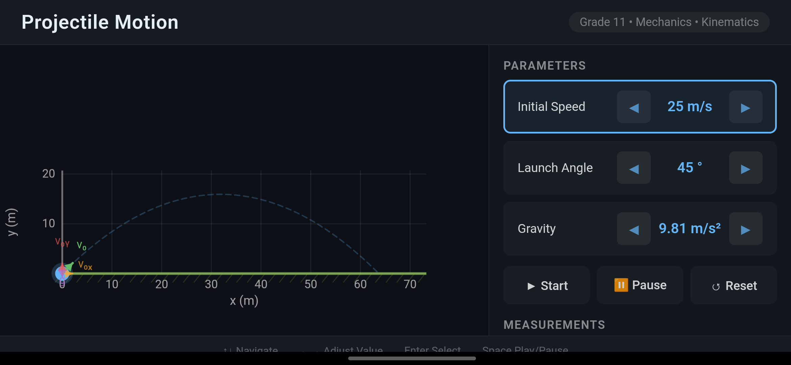
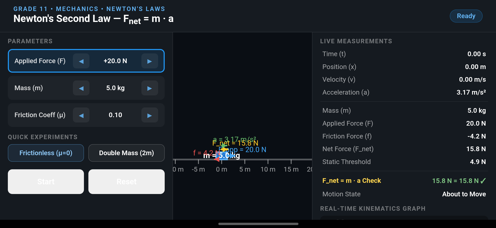
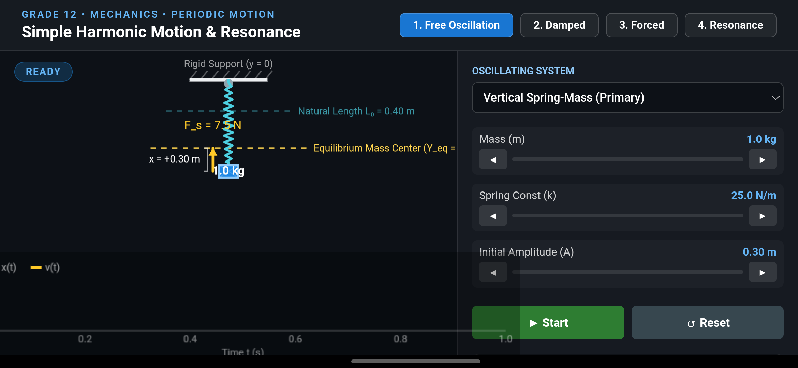
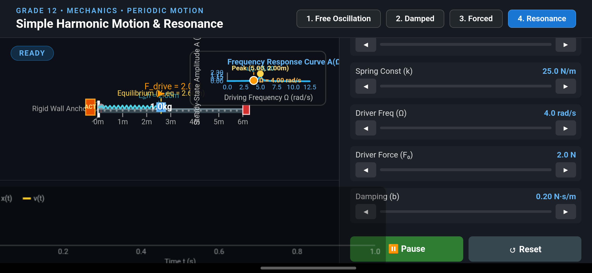
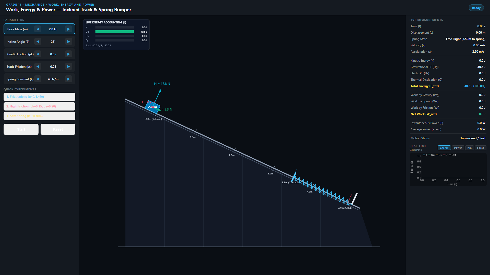

# Physics Lab

Interactive physics simulations for Grade 11 and Grade 12 secondary-level Physics curriculum (Curriculum Development Centre, Nepal). Engineered for offline-first Android TV classroom displays, desktop web browsers, and touch devices.

> [!NOTE]
> **Institutional Disclaimer:** Physics Lab is an independent educational software project developed with classroom use in mind. It is not an official product or endorsement of the Curriculum Development Centre, Ministry of Education, or Shree Public High School.

---

## Product Vision & Scope

**Physics Lab is an interactive simulation laboratory**, inspired by the active learning approach of PhET Interactive Simulations.

The student experience centers on **experimentation, observation, and quantitative inquiry**:
- Adjust physical parameters (e.g., launch angle, initial speed, applied force, mass, spring constant, damping coefficient, driving frequency).
- Observe real-time physical responses, dynamic vectors, and trajectory paths.
- Analyze live measurements, waveforms, and analytical response curves.
- Operate with intuitive Start, Pause, Step, and Reset controls.
- Navigate seamlessly with an Android TV remote control / D-pad in an offline classroom environment.

### Explicit Scope Boundaries (What Physics Lab Is NOT)
To ensure high simulation fidelity and focused pedagogical impact, the following are strictly out of scope:
- **NOT a digital textbook or lecture note reader:** No chapter essays, theoretical textbook reproductions, or written articles.
- **NOT a Learning Management System (LMS):** No student accounts, authentication, cloud sync, or profile tracking.
- **NOT an assessment or grading platform:** No question banks, multiple-choice quizzes, homework grading, or exam engines.
- **NOT an AI tutor or cloud service:** No LLM chatbots, external API calls, or backend microservices.

### Role of Curriculum Documentation
Official Nepal CDC curriculum specifications (`docs/curriculum/`) serve strictly as an **internal engineering reference** to verify mathematical models, map chapter competencies, and guarantee curriculum alignment. The application runtime maintains only lightweight metadata necessary for topic navigation and simulation launching.

---

## Screenshot Gallery

| Simulation | Screenshot |
|---|---|
| **Projectile Motion**<br>*Grade 11, Chapter 3: Kinematics* |  |
| **Newton's Second Law**<br>*Grade 11, Chapter 4: Dynamics* |  |
| **SHM — Free Oscillation**<br>*Grade 12, Chapter 2: Periodic Motion* |  |
| **SHM — Mechanical Resonance**<br>*Grade 12, Chapter 2: Periodic Motion* |  |
| **Work, Energy & Power**<br>*Grade 11, Chapter 5: Work, Energy and Power* |  |

Full photographic and screenshot documentation is available in the QA archives:
- [Complete Simulation Screenshots](docs/qa/screenshots/)
- [Android Runtime Integration QA Captures](docs/qa/android-runtime/)
- [Regression Test QA Captures](docs/qa/regression/)
- [Browser QA Captures — Work, Energy & Power](docs/qa/browser/work-energy-power/)

---

## Implemented Simulations

Physics Lab currently includes four fully implemented, curriculum-aligned simulations:

### 1. Projectile Motion — *Grade 11, Chapter 3: Kinematics*
- **Physics Model:** Closed-form analytic 2D kinematics with independent horizontal and vertical equations of motion ($v_x = v_0 \cos\theta$, $y(t) = v_0 \sin\theta \cdot t - \frac{1}{2}gt^2$).
- **Features:** Dynamic trajectory trail plotting, animated velocity vector and horizontal/vertical component vectors, gravitational acceleration vector, 1080p responsive ground grid.
- **Adjustable Parameters:** Initial velocity ($v_0$: $1\text{--}50\text{ m/s}$), launch angle ($\theta$: $0^\circ\text{--}90^\circ$ with robust vertical-launch sampling), gravitational acceleration ($g$: $1.0\text{--}25.0\text{ m/s}^2$).
- **Measurements:** Horizontal range ($R$), maximum height ($H$), time of flight ($T$), instantaneous velocity ($v$), and live $(x, y)$ coordinates.

### 2. Newton's Second Law of Motion — *Grade 11, Chapter 4: Dynamics*
- **Physics Model:** Dynamic force balance and acceleration calculation ($F_{\text{net}} = F_{\text{app}} - f = ma$) with Coulomb friction threshold modeling.
- **Features:** Distinguishes static breakaway friction ($f_s \le \mu_s N$) from kinetic sliding friction ($f_k = \mu_k N$), smooth zero-crossing velocity arrest, dynamic tracking camera following the sliding block, and scaled normal ($N$), weight ($W$), applied ($F_{\text{app}}$), friction ($f$), and net ($F_{\text{net}}$) force vectors.
- **Adjustable Parameters:** Block mass ($m$: $0.5\text{--}50\text{ kg}$), applied horizontal force ($F_{\text{app}}$: $-200\text{--}+200\text{ N}$), static friction coefficient ($\mu_s$: $0.0\text{--}1.0$), kinetic friction coefficient ($\mu_k \le \mu_s$).
- **Measurements:** Applied force, static/kinetic friction force, net force, instantaneous acceleration ($a$), velocity ($v$), and displacement ($x$).

### 3. Simple Harmonic Motion & Resonance — *Grade 12, Chapter 2: Periodic Motion*
Features four distinct simulation modes covering the complete periodic motion unit:
- **Mode 1 — Free Oscillation:**
  - *Vertical Spring-Mass System:* Physical ceiling anchor, coiled spring with equilibrium calculation ($Y_{\text{eq}} = -(L_0 + \Delta l + h_{\text{block}}/2)$), velocity and restoring force/acceleration vectors, and real-time energy conservation bar graph ($E_k, E_p, E_{\text{total}}$).
  - *Simple Pendulum:* Small-angle regime ($\theta \le 15^\circ$) showing natural frequency $\omega = \sqrt{g/L}$, angular trajectory, and tangential/radial vector decomposition.
- **Mode 2 — Damped Oscillation:**
  - Viscous damping force ($F_{\text{drag}} = -b v$) with continuous transitions across **underdamped** ($b < 2\sqrt{km}$), **critically damped** ($b = 2\sqrt{km}$), and **overdamped** ($b > 2\sqrt{km}$) regimes.
  - Features real-time phase space $(x, v)$ orbit visualization and live displacement-time $x(t)$ waveform with exponential decay envelope.
- **Mode 3 — Forced Oscillation:**
  - External sinusoidal driving force ($F(t) = F_0 \cos(\Omega t)$) acting on a damped oscillator.
  - Demonstrates initial transient beating and subsequent convergence to steady-state oscillation at the driving frequency $\Omega$ with phase lag $\delta$.
- **Mode 4 — Mechanical Resonance:**
  - Horizontal air-track spring apparatus ($L_{0,h} = 2.50\text{ m}$) driven near its natural frequency $\omega_0 = \sqrt{k/m}$.
  - Live analytical resonance curve $A(\Omega) = \frac{F_0/m}{\sqrt{(\omega_0^2 - \Omega^2)^2 + 4\gamma^2\Omega^2}}$ with peak resonance marker at $\Omega_r = \sqrt{\omega_0^2 - 2\gamma^2}$ and half-power bandwidth ($\Delta \omega \approx 2\gamma$).
  - Physical guide-rail travel limits with non-collapsing terminal state preservation.

### 4. Work, Energy & Power — *Grade 11, Chapter 5: Work, Energy and Power*
- **Physics Model:** Incline-aligned 1D coordinate system integrated via a semi-implicit Velocity Verlet numerical engine ($\Delta t = 0.002\text{ s}$).
- **Features:** Dynamic sliding block on an inclined track ($10^\circ\text{--}45^\circ$) with Coulomb friction, free flight, guided compression spring bumper at $s = 3.50\text{ m}$, solid spring compression limit at $s = 4.90\text{ m}$, and live energy accounting HUD overlay.
- **Adjustable Parameters:** Block mass ($m$: $0.5\text{--}10\text{ kg}$), incline angle ($\theta$: $10^\circ\text{--}45^\circ$), kinetic friction coefficient ($\mu_k$: $0.0\text{--}0.50$), static friction coefficient ($\mu_s \ge \mu_k$: $0.0\text{--}0.60$), spring constant ($k$: $10\text{--}200\text{ N/m}$), and quick presets (Frictionless, High Friction, Stiff Spring).
- **Measurements & Analytical Graphs:**
  - Live measurement panel displaying displacement, velocity, acceleration, spring state, work breakdown ($W_g, W_s, W_f, W_{\text{net}}$), and instantaneous/average power.
  - Four selectable real-time graph tabs with legend wrapping and D-pad navigation:
    - **Energy vs. Time:** Tracks kinetic ($K$), gravitational potential ($U_g$), elastic potential ($U_s$), thermal dissipation ($Q$), and conserved total energy ($E_{\text{tot}} = E_0$).
    - **Power vs. Time:** Real-time component and net instantaneous power ($P_g, P_s, P_f, P_{\text{net}}$).
    - **Kinematics vs. Time:** Displacement velocity $v(t)$ and acceleration $a(t)$.
    - **Force vs. Displacement:** Static characteristic curves displaying gravity driving force $F_g$, Hooke's resistance $F_s$, and conservative resultant $F_{\text{cons}} = F_g + F_s$.

*(Note: Additional curriculum topics remain planned for future development and are not listed as implemented.)*

---

## Technology Stack & Architecture

Physics Lab employs a clean two-layer decoupled architecture:

```text
┌────────────────────────────────────────────────────────┐
│                 Android TV Application                 │
│                                                        │
│            Kotlin + Jetpack Compose for TV             │
│   Home Screen → Grade Screen → Chapter / Sim Launcher  │
│                           │                            │
│                           ▼                            │
│     AndroidX WebKit + WebViewAssetLoader (Offline)     │
│       Virtual domain: https://appassets.androidplatform.net/assets/...
└───────────────────────────┼────────────────────────────┘
                            │
┌───────────────────────────▼────────────────────────────┐
│              Simulation Web Application                │
│                                                        │
│     TypeScript  •  HTML5 Canvas 2D  •  Vite  •  Vitest │
│                                                        │
│  Core Engine:     SimulationRegistry, SimulationClock, │
│                   Camera2D, Vector2, InputManager      │
│  Physics Models:  Pure math (analytic + numerical,     │
│                   semi-implicit Euler, Verlet)         │
│  Renderers:       CanvasRenderer, SHMRenderer,         │
│                   WorkEnergyRenderer, Graph            │
└────────────────────────────────────────────────────────┘
```

| Layer | Component | Technologies |
|---|---|---|
| **Android Shell** | TV UI & Navigation | Kotlin, Jetpack Compose for TV 1.1.0, Compose BOM 2026.09.00 |
| **Packaging** | Local Content Loading | AndroidX WebKit, `WebViewAssetLoader` (zero network calls, strict CORS) |
| **Engine** | Simulation Core | TypeScript 6.0, HTML5 Canvas 2D, Vite 8.3 |
| **Physics** | Mathematical Models | Pure TypeScript (analytic kinematics, semi-implicit Euler, damped/forced SHM, Velocity Verlet) |
| **Verification** | Test Harness | Vitest 5.0 (222 automated tests, 100% passing) |
| **Build System** | Compilation & Packaging | Android Gradle Plugin (AGP) 9.4.0, Gradle 9.6.1, JDK 17+ |

---

## Navigation & Controls

Physics Lab supports three unified interaction modes: Android TV remote controls (D-pad), desktop keyboards, and touchscreens.

| Action | Android TV Remote (D-Pad) | Desktop Keyboard | Touchscreen |
|---|---|---|---|
| **Navigate Controls** | `D-pad Up` / `D-pad Down` | `↑` / `↓` or `Tab` / `Shift+Tab` | Tap parameter row directly |
| **Adjust Values** | `D-pad Left` / `D-pad Right` | `←` / `→` (Hold `Shift` for coarse) | Tap `◀` / `▶` stepper buttons |
| **Activate / Select** | `D-pad Center` / `OK` | `Enter` | Tap button |
| **Play / Pause** | Action Button (`OK` on Start) | `Space` | Tap Start / Pause button |
| **Reset Simulation** | Action Button (`OK` on Reset) | `R` (or focus Reset + `Enter`) | Tap Reset button |
| **Back Navigation** | `Back` button | `Escape` / Browser Back | System back gesture / button |

---

## Verification & Testing Status

| Category | Status | Details |
|---|---|---|
| **Automated Test Suite** | ✅ **222 / 222 Passing** | 11 test files across core math, physics models, curriculum data, and rendering. |
| **TypeScript Typecheck** | ✅ **0 Errors** | Strict type checking (`tsc --noEmit`). |
| **Web Production Build** | ✅ **Clean** | Bundled via Vite with relative assets (`dist/assets/`, 133.1 kB). |
| **Android APK Build** | ✅ **Working** | Assembled via Gradle (`app-debug.apk`). |
| **Physical Phone Testing** | ✅ **Verified** | Validated on a physical Samsung Galaxy S21 FE (`SM-G990E`, Android 16) via ADB. Tested touch controls, D-pad key navigation, tab selection, DPR canvas scaling, and offline WebView execution. |
| **Physical Android TV Hardware** | ⏳ **Pending** | **Awaiting physical smart TV classroom hardware & physical IR/Bluetooth remote.** |

> [!WARNING]
> **Hardware Compatibility Note:** Testing on a physical Android smartphone validated the WebView runtime, touch inputs, DPR Canvas scaling, and simulated D-pad key events. However, smartphone testing does **not** prove compatibility with physical Android TV hardware, television display aspect ratios, or physical remote controls. Final TV validation will occur once physical classroom TV hardware is accessible.

---

## Quick Start & Development

### 1. Browser Simulation Development (Web Only)

No Android SDK is required for simulation development.

```bash
cd simulation-web

# Install dependencies
npm ci

# Start local development server
npm run dev
```

Open `http://localhost:5173` in your browser. The application supports URL hash routing to directly open individual simulations:
- `http://localhost:5173/#projectile-motion`
- `http://localhost:5173/#newtons-second-law`
- `http://localhost:5173/#simple-harmonic-motion`
- `http://localhost:5173/#work-energy-power`

### 2. Run Tests & Validation

```bash
cd simulation-web

# Run Vitest test suite
npm test

# Run TypeScript typecheck
npm run typecheck

# Build web production bundle
npm run build
```

### 3. Android APK Build

#### Prerequisites:
- **Node.js** 20+ and npm
- **JDK 17+** (Set `JAVA_HOME` in your environment)
- **Android SDK** with Platform API 37 and Build Tools 36.0.0 (Set `ANDROID_HOME` or `ANDROID_SDK_ROOT`)

#### Build Steps:

```powershell
# 1. Build the web application
cd simulation-web
npm run build
cd ..

# 2. Copy compiled web assets into the Android project
.\scripts\copy-web-assets.ps1

# 3. Assemble Android debug APK
cd android
.\gradlew.bat assembleDebug
```

Alternatively, run the automated all-in-one build script:
```powershell
.\scripts\build-all.ps1
```

The compiled APK will be generated at:
`android/app/build/outputs/apk/debug/app-debug.apk`

---

## Project Structure

```text
physics-lab/
├── .github/
│   └── workflows/
│       └── web-ci.yml                 # GitHub Actions CI for web test & build
│
├── android/                           # Android TV application
│   ├── app/
│   │   ├── src/main/
│   │   │   ├── java/com/physicslab/app/
│   │   │   │   ├── MainActivity.kt
│   │   │   │   ├── data/CurriculumData.kt
│   │   │   │   ├── navigation/NavGraph.kt
│   │   │   │   └── ui/screens/
│   │   │   │       ├── HomeScreen.kt
│   │   │   │       ├── GradeScreen.kt
│   │   │   │       ├── ChapterScreen.kt
│   │   │   │       └── SimulationScreen.kt
│   │   │   ├── res/
│   │   │   ├── assets/simulation-web/ # Bundled web assets (generated)
│   │   │   └── AndroidManifest.xml
│   │   └── build.gradle.kts
│   ├── gradle/libs.versions.toml
│   ├── settings.gradle.kts
│   └── build.gradle.kts
│
├── simulation-web/                    # TypeScript simulation application
│   ├── src/
│   │   ├── core/                      # Engine abstractions
│   │   │   ├── Camera2D.ts
│   │   │   ├── InputManager.ts
│   │   │   ├── Simulation.ts
│   │   │   ├── SimulationClock.ts
│   │   │   ├── SimulationRegistry.ts
│   │   │   └── Vector2.ts
│   │   ├── physics/                   # Pure mathematical models
│   │   │   ├── NewtonsSecondLawPhysics.ts
│   │   │   ├── ProjectilePhysics.ts
│   │   │   ├── SimpleHarmonicPhysics.ts
│   │   │   └── WorkEnergyPhysics.ts
│   │   ├── rendering/                 # Canvas apparatus renderers
│   │   │   ├── CanvasRenderer.ts
│   │   │   ├── SHMRenderer.ts
│   │   │   └── WorkEnergyRenderer.ts
│   │   ├── components/                # Analytical UI components
│   │   │   └── Graph.ts
│   │   ├── curriculum/                # Client-side curriculum metadata
│   │   │   └── curriculumData.ts
│   │   ├── simulations/               # Simulation implementations
│   │   │   ├── newtons-second-law/
│   │   │   ├── projectile-motion/
│   │   │   ├── simple-harmonic-motion/
│   │   │   └── work-energy-power/
│   │   └── main.ts                    # Entry point & hash router
│   ├── tests/                         # Vitest automated test suite
│   │   ├── core/                      # Vector2, Clock, Camera2D, Registry tests
│   │   ├── curriculum/                # Curriculum metadata tests
│   │   ├── physics/                   # Projectile, Newton, SHM, Work-Energy tests
│   │   └── rendering/                 # SHM & Work-Energy canvas rendering tests
│   ├── package.json
│   ├── tsconfig.json
│   ├── vite.config.ts
│   └── index.html
│
├── docs/                              # Project documentation
│   ├── architecture.md                # System architecture specification
│   ├── curriculum-map.md              # Curriculum alignment & mapping
│   ├── curriculum/                    # CDC curriculum reference materials
│   ├── simulation-specs/              # Mini-specs for implemented simulations
│   ├── testing/                       # Milestone verification reports
│   └── qa/                            # Verified visual QA screenshot captures
│
├── scripts/
│   ├── build-all.ps1                  # Full pipeline build script
│   └── copy-web-assets.ps1            # Web-to-Android asset synchronization
│
├── AGENTS.md                          # Coding agent guidelines & physics rules
├── LICENSE                            # MIT License
└── README.md                          # Project documentation
```

---

## License

This project is open-source software licensed under the [MIT License](LICENSE).  
Copyright (c) 2026 gyr0byte.
